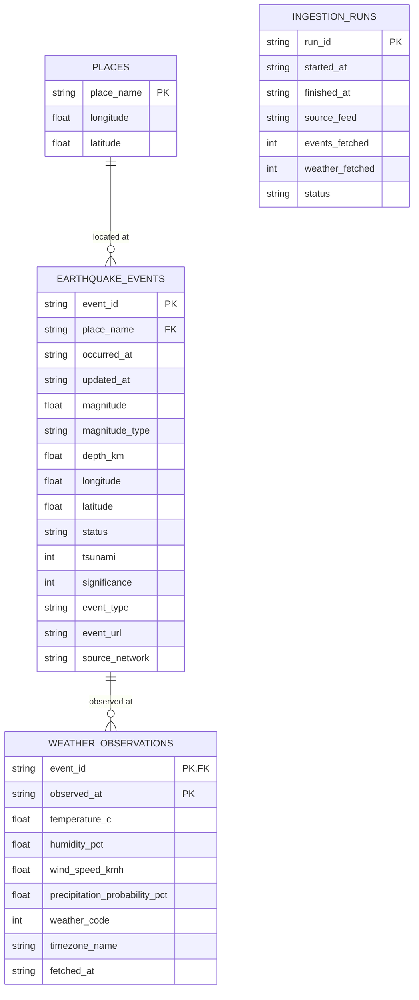

# ER Diagram — Real-Time Data Intelligence Platform (Track A)

Week 4 deliverable for the Saras course project "Data Pipelines with
Databricks and Airflow".

The diagram is drawn in Mermaid so GitHub renders it directly. The tables
are the 3NF Silver layer defined in `sql/create_tables.sql`; the Week 5
star schema in `sql/star_schema.sql` is built from these tables.

## Why this is in third normal form (3NF)

- **places** holds each place name once, with the coordinates first seen
  for it. The place text is normalised out of the event rows, so a place
  name is stored in exactly one place and there is no repeating group.
- **earthquake_events** is keyed by the USGS event id (`event_id`), a
  natural key. Every non-key column describes the event itself.
- **weather_observations** is keyed by the pair (`event_id`,
  `observed_at`): one weather reading per event per observation time.
- **ingestion_runs** is an audit table keyed by `run_id`; it records
  every load so re-runs can be traced.
- The event row carries the longitude and latitude observed for that
  event, while `places` holds the first-seen coordinates for the place
  name. The two can differ slightly (for example when a place name is
  reused for nearby events), so the event keeps its own observed values
  and `places` is a lookup, not the source of truth for coordinates.

## Week 5

The star schema in `sql/star_schema.sql` (`dim_time`, `dim_location`,
`dim_magnitude_band`, `dim_weather_condition`, `fact_earthquake_events`)
is the Gold layer derived from these 3NF tables.
